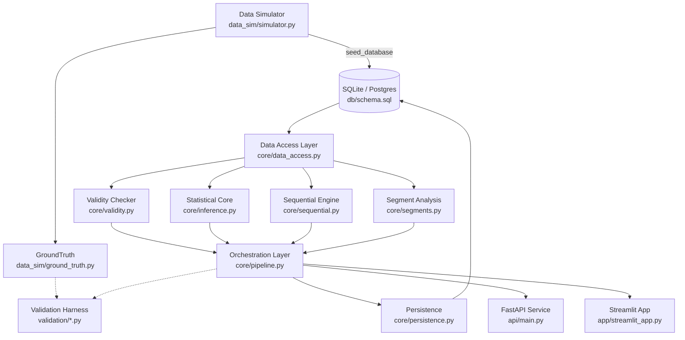

# A/B Test Analysis Engine

Structural enforcement of correct experimentation methodology — SRM detection,
power analysis, CUPED variance reduction, empirical peeking-inflation
correction, and BH-corrected segment analysis that flags effect reversals —
validated against synthetic data with known ground truth, not asserted from
a single run. Exposed both as a Python library, a REST API, and an
interactive report app.

> **Status:** complete. A full audit and the fixes it led to are recorded
> in [`docs/REVIEW.md`](docs/REVIEW.md) — including a miscalibrated
> peeking correction and a cross-experiment data-mixing bug, both fixed
> and covered by regression tests.

## Quick start

```bash
git clone <repo_url>
cd ab-test-engine
python -m venv venv && source venv/bin/activate   # Windows: venv\Scripts\activate
pip install -r requirements-dev.txt   # runtime + test/lint tools
pytest -m "not slow"
```

Runs in under 10 seconds and requires zero external services — SQLite only,
per NFR5.

**Try the interactive report app:**
```bash
streamlit run app/streamlit_app.py
```

**Try the API** (auto-generated interactive docs at `/docs`):
```bash
uvicorn api.main:app --reload
```

**Run the full validation suite** (release-gate evidence, not a per-commit
check — several minutes):
```bash
pytest validation/ -v -s -m slow --tb=short
```

## Optional authentication

Both services are open by default for local use. To require credentials,
set environment variables before starting them:

- `API_KEY` — every data endpoint then requires the same value in an
  `X-API-Key` header (`/` and `/health` stay open). `GET /health` returns
  200 only when the database answers a query.
- `APP_PASSWORD` — the Streamlit app asks for it once per browser session.

## Why this exists

Naive `p < 0.05` A/B testing fails in four specific, well-documented ways:

- **Underpowered or over-run tests** — no pre-registered sample size means
  teams either stop too early or run indefinitely past the point of value.
- **Peeking / repeated significance testing** — checking a dashboard daily
  and stopping the moment `p < 0.05` appears inflates the true false-positive
  rate far above the nominal 5%, invisibly.
- **Sample ratio mismatch (SRM)** — a broken randomization pipeline can
  silently invalidate every downstream statistic.
- **Effect heterogeneity** — an aggregate result can mask
  a strong effect in one segment and the opposite effect in another.

This engine makes the relevant checks mandatory and ordered, computes what
naive workflows skip (power, SRM, CI, calibrated peeking correction,
segment-level heterogeneity), and proves its own claims against synthetic
data with a known ground-truth effect — every validation number below was
measured by actually running the code, not asserted from theory.

## Architecture



The dashed box (Core Engine) is deliberate: each of its four modules is pure,
independently testable, and has zero awareness of the others except where
the spec explicitly calls for reuse (`core/segments.py` reuses
`core/inference.py`'s `raw_ttest_ci()` directly, mirroring the pooled
estimate). `core/persistence.py` is the *only* place validity and inference
results are allowed to meet, and it's structured so that meeting cannot
happen incorrectly — `trusted` is computed from the SRM result internally,
never accepted as a caller-supplied argument.

**API and Streamlit both call `core/pipeline.py` directly**, not each other
— a deliberate choice (documented in `app/streamlit_app.py`) favoring
simplicity for a local demo tool over an unnecessary HTTP round-trip.

## Project structure

```
ab-test-engine/
├── core/
│   ├── validity.py       # SRM chi-square check, power/MDE calculator
│   ├── inference.py      # Welch's t-test, CUPED adjustment, variance reduction
│   ├── sequential.py     # peeking-FPR simulation, O'Brien-Fleming + Lan-DeMets boundaries
│   ├── segments.py       # per-segment effects, BH correction, effect-reversal flag
│   ├── persistence.py    # the only writer of experiment_results.trusted
│   ├── data_access.py    # the only file with raw SQL
│   └── pipeline.py       # orchestration: ties the above into one report
├── data_sim/
│   ├── simulator.py      # ExperimentSimulator — synthetic data, known ground truth
│   └── ground_truth.py   # immutable record of configured-vs-realized parameters
├── db/
│   ├── schema.sql
│   ├── connection.py
│   └── seed.py           # seed_database() + seed_assignments_for_existing_experiment()
├── api/
│   ├── main.py            # FastAPI app, auto-docs at /docs
│   ├── schemas.py          # Pydantic request/response models
│   └── routers/
│       ├── experiments.py  # POST /experiments, POST /experiments/{id}/assign
│       └── analysis.py     # POST /experiments/{id}/analyze, GET /experiments/{id}/report
├── app/
│   ├── streamlit_app.py    # single-page report entrypoint
│   └── components/         # 5 panels: upload_or_generate, validity, effect, sequential, segment
├── tests/                # fast, closed-form/structural tests (pytest -m "not slow")
├── validation/           # slow, simulation-based proof (release gate, not per-commit)
├── notebooks/            # narrative walkthrough (regenerate: python generate_notebook.py)
├── config/
└── scripts/
```

## Validation evidence

Measured by actually running `validation/*.py`, not asserted — see
`validation/validation_report.md` for the full writeup.

| Claim | Target | Measured | Notes |
|---|---|---|---|
| CI coverage (n=2000, baseline=0.10) | 93%–97% | **94.4%** | Original configuration, 1000 sims. |
| CI coverage (small n=400) | 93%–97% | **94.4%** | Stress-tests Welch's df approximation at smaller n. |
| CI coverage (low baseline=0.02) | 93%–97% | **95.0%** | Stress-tests skew near the probability boundary. |
| CI coverage (high baseline=0.90) | 93%–97% | **95.4%** | Symmetric boundary stress test. |
| CUPED variance reduction @ ρ=0.3, null effect | ≈9.0% | **9.21%** | 200 sims, n=5000/arm. |
| CUPED variance reduction @ ρ=0.7, null effect | ≈49.0% | **48.67%** | Same config. |
| CUPED variance reduction, nonzero true effect | ≈25.0% | **23.87%** | Real, documented ~1pp systematic shift from effect-application mechanics — see validation file docstring. |
| CUPED variance reduction, continuous metric | ≈36.0% | **35.94%** | Proves the identity is metric-agnostic, not binary-only. |
| Naive peeking empirical FPR | ~19.3% (theory) | **19.95%** (399/2000) | 10 checkpoints × 200/arm, flat α=0.05. |
| O'Brien-Fleming corrected FPR | 5% (band 3.5%–7%) | **5.15%** (103/2000) | Calibrated constant c=2.0865; identical data (common random numbers). |
| Corrected FPR under irregular checkpoint spacing | Must beat naive | **4.80%** vs naive **20.45%** | Uneven daily-style spacing; no meaningful degradation vs. even spacing. |
| Lan-DeMets FPR, equal spacing | 5% (band 3.5%–7%) | **5.25%** (105/2000) | Information-based boundary — the default for live experiments. |
| Lan-DeMets FPR, irregular spacing | 5% (band 3.5%–7%) | **5.05%** (101/2000) | Calibrated to each look's actual information fraction, not assumed to be equal. |
| Revenue per conversion CI coverage (delta method) | 93%–97% | **94.8%** (474/500) | Log-normal order values (σ=1), n=4000. |
| Revenue per user CI coverage | 93%–97% | **95.2%** (476/500) | Same heavy-tailed order values. |
| Revenue per conversion CI coverage, CUPED | 93%–97% | **95.4%** (477/500) | Order values tied to the covariate; 6.4% mean variance reduction. |
| Multi-arm family-wise error (3 null arms) | ≤5% | **4.75%** Dunnett, **4.45%** Holm, **13.05%** unadjusted | 2000 sims, shared control. |
| Segment heterogeneity (Q test), homogeneous effect | ~5% | **4.60%** | 1000 sims, region segments. |
| Segment heterogeneity (Q test), real difference | ~87% (theory) | **88.5%** | 200 sims, device-type effects ±0.04. |
| Segment recovery (deliberately heterogeneous) | Correct sign, magnitude within noise | **Mobile: +0.147** (configured +0.15); **Desktop: -0.070** (configured -0.08) | Effect-reversal flag correctly fired on the significantly opposite segment. |

The naive→corrected trigger-position shift (naive triggers front-loaded at
early checkpoints; corrected triggers essentially never at the first looks
and concentrated late) is direct evidence the correction targets the
intended failure mode — early-look noise — not just a uniform threshold
reduction.

An earlier version of the boundary used c = 1.96 instead of a calibrated
constant; its exact false-positive rate is ~6.9%, and it measured 6.6% at
500 simulations. See `docs/REVIEW.md` (issue H2) for how this was found
and fixed.

## Capabilities beyond a two-arm conversion test

- **Metrics:** `conversion` (Welch t-test), `revenue_per_user` (Welch,
  optional winsorization at a pooled quantile, CUPED-eligible) and
  `revenue_per_conversion` (average order value — a ratio metric, analysed
  with the delta method at the user level, with CUPED applied to its
  per-user linearization). Select with
  `analyze_experiment(metric_name=...)` or the API's `metric` field.
- **A/B/n experiments:** any number of treatment arms. Each arm is compared
  with control; step-down Dunnett-adjusted p-values (built from each
  comparison's own standard error and the shared-control correlation)
  control the family-wise error rate across arms, with Holm as an option
  (`multiple_comparison=`, `AnalysisReport.comparisons`).
- **Segment heterogeneity:** Cochran's Q test of whether segment effects
  differ, and one Benjamini-Hochberg correction across every segment, column
  and arm in a report.
- **Stored schedules and reports:** the planned checkpoint schedule lives on
  the experiment (`PUT /experiments/{id}/schedule`), and `GET /report`
  serves the stored result of the latest `POST /analyze` without
  recomputation.
- **Real data:** `POST /experiments/{id}/ingest` (JSON rows) and the
  Streamlit CSV upload share `core/ingestion.py`: map the file's own column
  names onto variant / converted / revenue / user id / covariate / segment
  roles, map raw variant labels (e.g. "A"/"B") onto control and arms or
  drop them, and read conversion flags written as 0/1, true/false or
  yes/no.
- **Sequential monitoring per arm and metric:** each look
  (`POST /experiments/{id}/checkpoints`, or the app's "Log this checkpoint")
  is recorded for every treatment arm on a given metric, and the peeking
  check runs per arm (`AnalysisReport.sequential_risks`). The planned sample
  size can change mid-test: thresholds already used keep their recorded
  values and the alpha they spent is carried forward under the new plan.

## Known limitations (stated directly, not discovered later)

- Live peeking checks use a **Lan-DeMets** boundary (O'Brien-Fleming-type
  spending, α(t) = 4 − 4Φ(z_{α/4}/√t)) driven by each look's information
  fraction, so irregular look times are handled exactly. It matches
  published `ldbounds` values to ~0.001 in z. A look past the planned
  total spends nothing (it cannot reject) until the plan is increased; plan
  changes must not be driven by the observed effect, or the error guarantee
  no longer holds. The index-based O'Brien-Fleming schedule remains
  available (`spending="obrien_fleming"`) for planned equal spacing.
- The multi-arm Dunnett adjustment uses the large-sample normal
  approximation for the joint distribution of the comparisons. The
  sequential check corrects for repeated looks within each arm, not jointly
  across arms.
- The Cochran's Q heterogeneity test has low power with few or small
  segments; a large p-value is not evidence that effects are equal.
- No deployment setup is included. Authentication is one shared API key
  (not per-user accounts), with no TLS or rate limiting. `DATABASE_URL` can
  point at Postgres, but the driver is not in `requirements.txt` and the
  schema is only tested on SQLite.
- Real data must arrive as one row per user (variant, conversion and
  optional revenue, covariate and segments); event-level logs need
  aggregating to users first.
