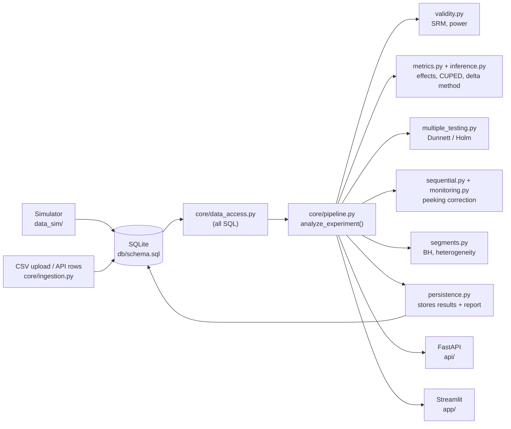

# A/B Test Analysis Engine

An engine for analysing A/B tests **correctly**. You give it an experiment
(simulated, uploaded, or sent through an API) and it produces a report that
checks the experiment is trustworthy before estimating anything: is the
traffic split healthy, was the test big enough, how large is the effect and
how sure are we, did repeatedly checking the results inflate false
positives, and does the effect differ between user segments.

Every statistical method in it is checked against simulated experiments
where the true answer is known, and the results of those checks are
published below.

It can be used three ways: an interactive **Streamlit** report app, a
**REST API** (FastAPI), or as a **Python library**.

---

## Why this exists

The common way to read an A/B test ("treatment beat control, p < 0.05, ship
it") goes wrong in four well-known ways:

| Problem | What happens | What this engine does |
|---|---|---|
| **Broken randomization** (sample ratio mismatch) | A bug sends users to the variants in the wrong proportions, and every number downstream is quietly invalid. | Runs a chi-square SRM check first and marks the report untrusted if it fails. |
| **Underpowered tests** | A "no difference" result from a test too small to detect anything is read as proof of no effect. | Reports the smallest effect the test could reliably have detected. |
| **Peeking** | Checking results every day and stopping at the first p < 0.05 makes the real false-positive rate several times the advertised 5% (about 20% with 10 looks). | Corrects the threshold for every look with a group-sequential boundary (Lan-DeMets), so the overall rate stays at 5%. |
| **Hidden segment differences** | An average effect can hide a segment where the treatment does harm. | Breaks results down by segment, corrects for testing many segments, tests whether segment effects differ, and flags segments where the effect reverses. |

---

## Quick start

Requires Python 3.11+. Everything runs locally with SQLite; no external
services.

```bash
git clone https://github.com/tarun-rai21/ab-test-engine.git
cd ab-test-engine
python -m venv venv
source venv/bin/activate            # Windows: venv\Scripts\activate
pip install -r requirements-dev.txt # requirements.txt alone is enough to run, not test
```

**Open the report app** — the quickest way to see what it does:

```bash
streamlit run app/streamlit_app.py
```

Click **Generate data** (a simulated experiment with a known true effect),
then **Run analysis**. Try ticking *Simulate a broken randomization* to see
the SRM warning, adding a second treatment arm, choosing a revenue metric,
selecting segments, or enabling the peeking check and logging a few
checkpoints. You can also upload your own CSV (see [Using your own
data](#using-your-own-data)).

**Start the API** — interactive documentation at http://localhost:8000/docs:

```bash
uvicorn api.main:app --reload
```

**Run the tests:**

```bash
pytest -m "not slow"                       # ~240 fast tests, about a minute
pytest validation/ -m slow -v -s           # simulation-based validation, ~12 minutes
```

---

## What a report contains

1. **Validity** — the SRM check (observed vs. intended split) and the
   smallest effect the sample size could detect.
2. **Effect estimate** — the treatment-minus-control difference with a 95%
   confidence interval and p-value, both raw and CUPED-adjusted (CUPED uses
   each user's pre-experiment behaviour to remove noise, giving a narrower
   interval for the same effect). With several treatment arms, one row per
   arm with p-values adjusted for comparing many arms.
3. **Peeking risk** — for each arm, whether the latest look is significant
   at the naive 0.05 and at the corrected threshold. "Significant naively,
   not after correction" is the classic peeking false positive.
4. **Segments** — per-segment effects (e.g. mobile vs. desktop), a
   Benjamini-Hochberg correction across every segment tested, a test of
   whether the segment effects differ at all, and a flag for segments whose
   effect significantly reverses the overall result.

### Metrics

| Metric | Meaning | Method |
|---|---|---|
| `conversion` | Share of users who converted | Welch's t-test |
| `revenue_per_user` | Mean revenue per user (0 for non-buyers) | Welch's t-test, optional winsorization of extreme values |
| `revenue_per_conversion` | Average order value — a ratio of two random quantities | Delta method at the user level |

CUPED applies to all three.

---

## Using the API

A typical session with simulated data: create an experiment, fill it,
record a look, analyse it, read the stored report. (Real data is loaded
with `/ingest` instead of `/assign` — see [Using your own
data](#using-your-own-data).)

```bash
# 1. Create an experiment with three variants and a planned monitoring schedule
curl -X POST localhost:8000/experiments -H "Content-Type: application/json" -d '{
  "name": "New checkout",
  "variants": [
    {"name": "control", "split_pct": 0.5},
    {"name": "treatment", "split_pct": 0.25},
    {"name": "treatment_b", "split_pct": 0.25}
  ],
  "schedule": {"n_checkpoints_planned": 4, "checkpoint_n": 2000}
}'
# -> {"experiment_id": "exp_1a2b3c4d5e6f", "status": "created"}

# 2. Fill it with 8000 simulated users (treatment has a true +0.03 effect)
curl -X POST localhost:8000/experiments/exp_1a2b3c4d5e6f/assign -H "Content-Type: application/json" \
  -d '{"n_users": 8000, "baseline_rate": 0.10, "arm_effects": {"treatment": 0.03}}'

# 3. Record a "look" (each arm's current p-value) for peeking-risk monitoring
curl -X POST localhost:8000/experiments/exp_1a2b3c4d5e6f/checkpoints -H "Content-Type: application/json" \
  -d '{"metric": "conversion"}'

# 4. Analyse (the full report is stored), then read it back without recomputing
curl -X POST localhost:8000/experiments/exp_1a2b3c4d5e6f/analyze -H "Content-Type: application/json" \
  -d '{"metric": "conversion", "segment_columns": ["device_type"]}'
curl localhost:8000/experiments/exp_1a2b3c4d5e6f/report?metric=conversion
```

| Endpoint | Purpose |
|---|---|
| `POST /experiments` | Create an experiment (variants, intended split, optional schedule) |
| `PUT /experiments/{id}/schedule` | Set or change the planned monitoring schedule |
| `POST /experiments/{id}/assign` | Generate simulated data |
| `POST /experiments/{id}/ingest` | Load real data |
| `POST /experiments/{id}/checkpoints` | Record a look for peeking-risk monitoring |
| `POST /experiments/{id}/analyze` | Run and store the full analysis |
| `GET /experiments/{id}/report` | Read the stored report |
| `GET /health` | Health check (database reachable) |

## Using it as a Python library

```python
from core.pipeline import analyze_experiment
from db.connection import create_memory_engine
from db.seed import seed_database

engine = create_memory_engine()
seed_database({"simulator": {
    "n_users": 20000, "baseline_rate": 0.10, "true_effect": 0.02,
    "covariate_correlation": 0.5, "seed": 7,
}}, engine=engine)

report = analyze_experiment(engine, "exp_seed7", segment_columns=["device_type"])
print(report.srm.flagged)                        # False: the split is healthy
print(report.cuped_effect.point_estimate)        # close to the true +0.02
print(report.cuped_effect.ci_lower, report.cuped_effect.ci_upper)
```

## Using your own data

Data must be **one row per user**. Column names and variant labels can be
anything; you map them:

| Role | Required? | Example values |
|---|---|---|
| variant | yes | `A` / `B` / `QA` — mapped to `control`, `treatment`, `treatment_b`, … or dropped |
| converted | yes, unless revenue is given | `1`/`0`, `true`/`false`, `yes`/`no` |
| revenue | for revenue metrics | `42.50` (0 for users who didn't buy) |
| user id | no | `u123` |
| pre-period covariate | for CUPED | e.g. spend in the 30 days before the test |
| device type, region, existing customer | for segment analysis | `mobile`, `EU`, `true` |

The Streamlit upload has a mapping step for this. The API takes the same
mapping, with one JSON object per user — here a spreadsheet whose `group`
column holds `A`/`B`/`QA` and whose `bought` column holds yes/no:

```bash
curl -X POST localhost:8000/experiments/<experiment_id>/ingest -H "Content-Type: application/json" -d '{
  "rows": [
    {"user": "u1", "group": "A", "bought": "yes", "spend": 42.5},
    {"user": "u2", "group": "B", "bought": "no",  "spend": 0},
    {"user": "u3", "group": "QA", "bought": "no", "spend": 0}
  ],
  "columns": {"variant": "group", "converted": "bought", "revenue": "spend", "user_id": "user"},
  "variant_values": {"A": "control", "B": "treatment", "QA": null}
}'
```

Rows mapped to `null` (here, QA traffic) are dropped, and the variant names
must match the experiment's variants. A file that already uses the names
`variant_id` (values ending in `_control` / `_treatment`) and `converted`
needs no mapping.

---

## How it works



`analyze_experiment()` runs the steps in a fixed order: SRM check → achievable
effect size → effect per arm (raw and CUPED) with multiple-arm adjustment →
peeking check per arm → segment analysis → store everything in one
transaction. Two design rules keep it trustworthy:

- **Validity is checked before inference**, and a result can only be marked
  `trusted` from the SRM result itself — never by the caller.
- **The statistical modules are pure functions** with no database access, so
  each is tested on its own against known answers. Only `data_access.py`
  contains SQL.

### Project structure

```
ab-test-engine/
├── core/                    # the engine
│   ├── pipeline.py          # analyze_experiment(): runs every step, builds the report
│   ├── validity.py          # SRM check, sample size / minimum detectable effect
│   ├── inference.py         # Welch's t-test, CUPED, delta method
│   ├── metrics.py           # which metric means what, and how it is estimated
│   ├── multiple_testing.py  # Dunnett and Holm adjustments for multiple arms
│   ├── sequential.py        # peeking correction (O'Brien-Fleming, Lan-DeMets)
│   ├── monitoring.py        # recording looks at a live experiment
│   ├── segments.py          # segment effects, BH correction, heterogeneity test
│   ├── ingestion.py         # mapping real data onto the schema
│   ├── persistence.py       # writing results and reports
│   └── data_access.py       # all SQL queries
├── data_sim/                # simulator with known ground truth
├── db/                      # schema, connection, seeding
├── api/                     # FastAPI service (routers, schemas, optional API key)
├── app/                     # Streamlit report app and its panels
├── tests/                   # fast tests, run in CI
├── validation/              # slow simulation-based validation + results report
├── notebooks/writeup.ipynb  # executed walkthrough of every feature
├── docs/REVIEW.md           # full code audit and the record of every fix
└── config/default_config.yaml  # default simulator settings for python -m db.seed
```

### Statistical methods and why

| Method | Used for | Why this choice |
|---|---|---|
| Chi-square goodness of fit, flag at p < 0.001 | SRM | Run on every analysis, so a strict threshold avoids false alarms; real SRM bugs are large. |
| Welch's t-test | Effects | Does not assume treatment leaves the variance unchanged. |
| CUPED | Variance reduction | Removes noise explained by pre-experiment behaviour without changing what is measured; reduction ≈ 100·ρ². |
| Delta method | Ratio metric | Keeps the user as the unit; treating each order as independent would understate uncertainty. |
| Step-down Dunnett | Several arms vs. one control | Controls the chance of any false winner; uses the correlation from the shared control, so less conservative than Holm. |
| Lan-DeMets spending (O'Brien-Fleming type) | Peeking | Keeps the overall false-positive rate at 5% for any timing of looks, and supports changing the planned sample size mid-test. |
| Benjamini-Hochberg | Segments | Controls the share of false discoveries across many exploratory segment tests. |
| Cochran's Q | Segments | Tests whether segment effects actually differ, which per-segment significance cannot show. |

---

## Validation evidence

Each claim is checked by simulating many experiments where the true effect
is known (`validation/`, details in
[`validation/validation_report.md`](validation/validation_report.md)).
All numbers below come from running that suite.

| Claim | Target | Measured |
|---|---|---|
| 95% confidence intervals contain the true effect | 93%–97% | 94.4%–95.4% across 4 configurations |
| CUPED variance reduction matches theory (ρ = 0.3 / 0.7) | 9% / 49% | 9.21% / 48.67% |
| Revenue metric intervals (heavy-tailed order values) | 93%–97% | 94.8% per conversion, 95.2% per user, 95.4% per conversion with CUPED |
| False-positive rate when peeking 10 times, uncorrected | ~19% (theory) | 19.95% |
| …with the O'Brien-Fleming correction | 5% | 5.15% (4.80% with irregular look times) |
| …with the Lan-DeMets correction | 5% | 5.25% equal spacing, 5.05% irregular |
| Chance of a false winner among 3 null arms | ≤ 5% | 4.75% Dunnett, 4.45% Holm (13.05% uncorrected) |
| Heterogeneity test false alarms / detection | 5% / ~87% | 4.60% / 88.5% |
| Recovering a deliberately reversed segment effect | correct sign and size | mobile +0.147 (true +0.15), desktop −0.070 (true −0.08), reversal flagged |

---

## Configuration

| Environment variable | Effect |
|---|---|
| `DATABASE_URL` | Database for the API and scripts (default `sqlite:///local.db`). The Streamlit app always uses a private in-memory database per browser session. |
| `API_KEY` | If set, every data endpoint requires it in an `X-API-Key` header (`/` and `/health` stay open). |
| `APP_PASSWORD` | If set, the Streamlit app asks for it once per browser session. |

`python -m db.seed` fills `local.db` with a demo experiment using
`config/default_config.yaml`.

## Limitations

- Data must be one row per user; event-level logs need aggregating first.
- The peeking correction controls false positives within each arm, not
  jointly across arms. Changes to the planned sample size must not be
  driven by the results seen so far.
- The Dunnett adjustment uses a large-sample normal approximation.
- The heterogeneity test has low power with few or small segments; a large
  p-value is not evidence that segment effects are equal.
- No deployment setup is included. Authentication is a single shared API
  key with no TLS or rate limiting. Only SQLite is tested.

## Further reading

- [`notebooks/writeup.ipynb`](notebooks/writeup.ipynb) — an executed
  walkthrough of every feature on simulated data.
- [`validation/validation_report.md`](validation/validation_report.md) — the
  validation setup and results in detail.
- [`docs/REVIEW.md`](docs/REVIEW.md) — a full audit of an earlier version
  and the record of every fix since (including a peeking correction that
  allowed ~7% false positives and a bug that mixed data between
  experiments).
